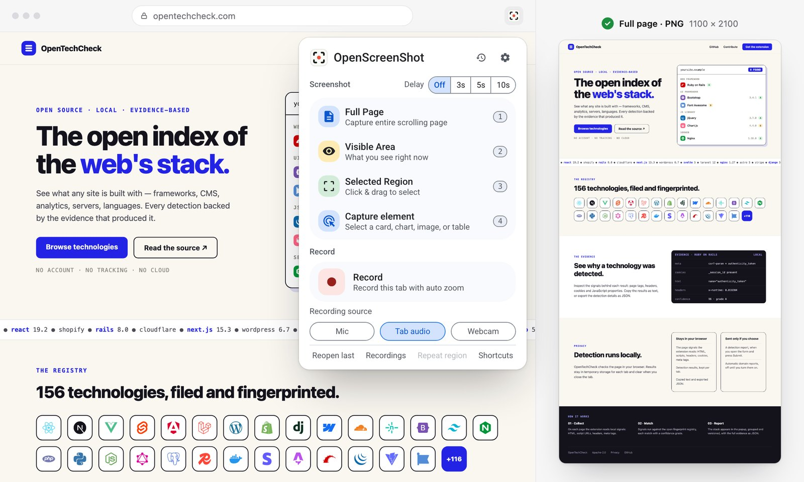

<div align="center">


# OpenScreenShot

**The whole page. One click. Yours to keep.**

Open-source full-page screenshot extension for Chrome and Firefox. Capture, annotate, blur,
export as PNG, JPEG, WebP, or PDF, and record a tab. Everything runs on your device. No account.

[](https://github.com/PGHQdev/OpenScreenShot/actions/workflows/ci.yml) [](https://github.com/PGHQdev/OpenScreenShot/actions/workflows/release.yml) [](https://github.com/PGHQdev/OpenScreenShot/actions/workflows/release-firefox.yml) [](https://github.com/PGHQdev/OpenScreenShot/actions/workflows/publish-mcp.yml)

[](./LICENSE) [](https://chromewebstore.google.com/detail/hdabbojjccojlapnfjpdppcpfcnhgmdp) [](https://addons.mozilla.org/firefox/addon/openscreenshot/)

<br />

<table>
<tr>
<td align="center" width="280">
<a href="https://chromewebstore.google.com/detail/hdabbojjccojlapnfjpdppcpfcnhgmdp">


<br />
<strong>Add to Chrome</strong>
</a><br />
<sub>Chrome · Edge · Brave · Arc · Chromium</sub>
</td>
<td align="center" width="280">
<a href="https://addons.mozilla.org/firefox/addon/openscreenshot/">
<br />
<strong>Add to Firefox</strong>
</a><br />
<sub>Firefox for desktop · 140+</sub>
</td>
</tr>
<tr>
<td align="center" width="280">
<a href="#mcp">


<picture>
<source media="(prefers-color-scheme: dark)" srcset="site/public/assets/brands/grok-dark.svg" />

</picture>
<br />
<strong>MCP</strong>
</a><br />
<sub>Local server · client setup required</sub>
</td>
<td align="center" width="280">
<a href="#cli">
<br />
<strong>CLI</strong>
</a><br />
<sub>Terminal · scripts · CI/CD</sub>
</td>
</tr>
</table>

[Website](https://openscreenshot.app) &nbsp;·&nbsp; [Docs](https://openscreenshot.app/docs/) &nbsp;·&nbsp; [Roadmap](./ROADMAP.md) &nbsp;·&nbsp; [Report a bug](https://github.com/PGHQdev/OpenScreenShot/issues)

<br />



<sub>Chrome preview. Screenshot capture and editing are also available in Firefox.</sub>

</div>

Capture the whole web page, crop it, mark it up, blur what is private, and save it as an
image or a PDF. Every step runs in your browser: nothing is uploaded, and there is no account.

## Capture → edit → share

- **One click, whole page** — the toolbar icon captures the entire scrolling page,
  even behind sticky headers and inside nested scrollers (a settings toggle restores
  the mode picker)
- **Visible area, region, and element capture** from the popup, the right-click menu,
  or keyboard shortcuts, with an optional 3, 5, or 10 second delay
- **Annotate** with arrows, shapes, text, numbered steps, spotlight, highlighter, and crop,
  with full undo
- **Blur or redact secrets** before you share: soft blur, mosaic, or an opaque fill
- **Record the tab in Chrome** with auto-zoom at your clicks, mic and webcam, and trim. Pick
  the part of the tab to record and check your camera first; the controls stay out of the video
- **Export** as PNG, JPEG, WebP, or multi-page PDF, or copy straight to the clipboard
- **Script it** from a terminal, CI, or an AI agent with the [CLI and MCP server](#cli--mcp)

The full tour, every shortcut, and the settings reference live in the
[docs](https://openscreenshot.app/docs/).

### Guides

- [How to take a full-page screenshot in Chrome](https://openscreenshot.app/blog/full-page-screenshot-chrome/),
  and the same for [Edge, Firefox, Safari, Brave, Opera, Vivaldi, and Arc](https://openscreenshot.app/full-page-screenshot/)
- [Save a screenshot as a PDF](https://openscreenshot.app/blog/save-screenshot-as-pdf/) ·
  [Redact a screenshot](https://openscreenshot.app/blog/redact-screenshot/)
- [Screenshots from the command line](https://openscreenshot.app/blog/screenshot-cli/) ·
  [A local screenshot MCP server](https://openscreenshot.app/blog/screenshot-mcp-server/) ·
  [Screenshots in CI](https://openscreenshot.app/blog/screenshots-for-ci/)
- [Full-page screenshot extensions compared](https://openscreenshot.app/blog/full-page-screenshot-extensions/) ·
  [Alternatives to GoFullPage, FireShot, Awesome Screenshot, and more](https://openscreenshot.app/alternatives/)

## Install

|                                              | Chrome & Chromium                                                                             | Firefox                                                                     |
| -------------------------------------------- | --------------------------------------------------------------------------------------------- | --------------------------------------------------------------------------- |
| Install                                      | [Chrome Web Store](https://chromewebstore.google.com/detail/hdabbojjccojlapnfjpdppcpfcnhgmdp) | [Firefox Add-ons](https://addons.mozilla.org/firefox/addon/openscreenshot/) |
| Full-page, visible, region & element capture | ✓                                                                                             | ✓                                                                           |
| Annotations, redaction & local history       | ✓                                                                                             | ✓                                                                           |
| Image, PDF & clipboard export                | ✓                                                                                             | ✓                                                                           |
| Screen recording                             | Chrome                                                                                        | Not available                                                               |

Firefox requires **desktop version 140 or later**. The Chrome extension also works in
Edge, Brave, Arc, and other Chromium browsers. Screen-wide color picking and floating
capture windows appear only when the browser supports them.

### Your first screenshot

1. **Install** from your browser’s store and pin the extension to the toolbar.
2. **Click the icon** to capture the whole page. Right-click for visible-area and region capture.
3. **Edit and share** — annotate, redact, copy, or save an image or PDF.

Prefer a capture menu on every click? Turn off **Express mode** in settings.
For alternatives and a sourced feature comparison, see [How it compares](https://openscreenshot.app/compare/).

### Element capture

Choose **Capture element** from the page or extension right-click menu, or from
the popup when Express mode is off. Hover over a card, image, chart, or table to
highlight it. Use ↑ / ↓ to select a larger or smaller area, or ← / → to move
between elements without a mouse. Click or press Enter to capture; Esc cancels.

The capture follows your existing Editor, Clipboard, or Download setting. The
element must be fully visible: scroll it into view, or use the **Capture full
page** fallback offered for clipped elements. Content inside an iframe is
captured as part of the iframe's visible rectangle. No new permissions are needed.

## Private by design

`host_permissions` is empty: `activeTab` grants access on your click, and the extension
does not have standing access to every website. Captures, recordings, and edits stay
in local browser storage until you export or delete them. Chrome can optionally request
broader access for recording across sites; Firefox does not request recording permissions. Full policy: [PRIVACY.md](./PRIVACY.md).

<details>
<summary><b>Every permission, line by line</b></summary>

<br />

| Permission                           | Why                                                                                                                                          |
| ------------------------------------ | -------------------------------------------------------------------------------------------------------------------------------------------- |
| `activeTab`                          | Access the current tab — only when you click the extension, use a shortcut, or pick a capture from the right-click menu                      |
| `scripting`                          | Inject on-demand page functions for scroll-and-stitch, region selection, the quick-mode clipboard write, and the recording's click tracker   |
| `storage` (+ `unlimitedStorage`)     | Settings, the last region rect, editing drafts, a parked Record click, and stashing large full-page PNGs and recording chunks for the editor |
| `downloads`                          | Save exports, quick-mode captures, and recording exports to your Downloads folder                                                            |
| `contextMenus`                       | Add one capture submenu to the page right-click menu                                                                                         |
| `clipboardWrite`                     | Copy a screenshot from the editor or from quick mode; it never reads the clipboard                                                           |
| `offscreen` (Chrome)                 | Run the recording engine in a hidden document — `MediaRecorder` and the IndexedDB writes need a page context a service worker doesn't have   |
| `tabCapture` (Chrome, optional)      | Requested once, at your first recording; every recording after that starts in one click                                                      |
| `<all_urls>` (Chrome, optional host) | Only if you turn on "Record across sites" — keeps click tracking alive when a recording navigates to a new origin                            |

</details>

## Development

TypeScript (strict) + Preact, bundled by Vite + [@crxjs/vite-plugin](https://github.com/crxjs/crxjs).
One runtime dependency (Preact); unit tests with Vitest. Node.js 22.19+ and pnpm 10.33.0.

```bash
pnpm install --frozen-lockfile
pnpm run icons
```

|              | Chrome                                                                   | Firefox                                                                                         |
| ------------ | ------------------------------------------------------------------------ | ----------------------------------------------------------------------------------------------- |
| Develop      | `pnpm run dev`                                                           | `pnpm run dev:firefox`                                                                          |
| Build        | `pnpm run build`                                                         | `pnpm run build:firefox`                                                                        |
| Package      | `pnpm run package`                                                       | `pnpm run package:firefox`                                                                      |
| Load locally | `chrome://extensions` → **Developer mode** → **Load unpacked** → `dist/` | `about:debugging` → **This Firefox** → **Load Temporary Add-on** → `dist-firefox/manifest.json` |

```bash
pnpm typecheck
pnpm lint
pnpm test
pnpm format:check
pnpm lint:firefox   # validate dist-firefox/ after building
```

The [Firefox release guide](release/firefox/README.md) covers reviewer source archives,
verification, and automated Mozilla submissions. Tagged releases have separate Chrome
and Firefox workflows; store review determines when each update becomes available.

For the website, use `pnpm site:dev`; a push to `main` deploys it. See
[CONTRIBUTING.md](./CONTRIBUTING.md) for the contribution workflow.

<details>
<summary><b>Project structure</b></summary>

<br />

```
openscreenshot/
├── manifest.json            # MV3 manifest (crxjs entry)
├── public/                  # icons + i18n messages
├── src/
│   ├── background/          # service worker (capture + recording coordinator)
│   ├── content/             # on-demand capture funcs (scroll, region, recording click tracker)
│   ├── control/             # recording control tab: area, camera preview, Start/Stop (Preact)
│   ├── editor/              # annotation editor + export (Preact, own tab)
│   ├── offscreen/           # recording engine: MediaRecorder + IndexedDB chunks
│   ├── popup/               # popup UI (Preact)
│   ├── recorder/            # recording editor: timeline, zoom, trim, export (Preact, own tab)
│   └── shared/              # design tokens, messaging, storage, types, utils
├── mcp/                     # optional local CLI + MCP server
├── site/                    # Astro website + localized content
├── site-dist/               # generated site build, served by site-worker.js
├── tests/unit/              # unit tests (Vitest)
└── scripts/                 # icon + screenshot pipelines
```

</details>

## CLI & MCP

[](https://www.npmjs.com/package/openscreenshot) [](https://www.npmjs.com/package/openscreenshot)

`openscreenshot` (npm) is a separate, optional tool that drives the Chrome already on your
machine — also fully local. Node.js 22.12 or newer and Chrome, Chromium, or Edge are required.
The [package README](./mcp/README.md) has every option.

### CLI

```bash
npx openscreenshot shot https://example.com --out shot.png --full
```

Cover secrets before the pixels are written: `--redact "<css selector>"`,
`--redact-pattern email,phone,secret`, and `--redact-rect x,y,w,h` put black boxes over
their targets, and the capture fails rather than writes an image if a target moves.

### MCP

Add this server entry to your MCP client’s configuration, then call `capture_screenshot`
with `{ "url": "https://example.com", "fullPage": true }`:

```json
{
  "mcpServers": {
    "openscreenshot": { "command": "npx", "args": ["-y", "openscreenshot"] }
  }
}
```

Claude Code: `claude mcp add openscreenshot -- npx -y openscreenshot`.

The server runs locally over **stdio**. Your client must support launching a local MCP
process; clients that only accept remote MCP URLs need a compatible bridge. The tool returns
the PNG to the client, which may send it to a hosted model: use the `redact` input for data
that must not leave the device.

Built for the terminal-heavy parts of the job:

- **DevOps** — snapshot dashboards, status pages, and admin UIs straight into incident
  reports, runbooks, and postmortems, from cron or a chat command
- **CI/CD** — capture pages in your pipeline for docs, release notes, and visual diffs
  on every deploy: one command, no hosted service

## Contributing

Desktop and web apps are also in progress. Follow their development on the
[roadmap](./ROADMAP.md).

See [CONTRIBUTING.md](./CONTRIBUTING.md) and the [roadmap](./ROADMAP.md). If
OpenScreenShot is useful to you, you can [buy me a coffee](https://ko-fi.com/pghqdev).

## License

[MIT](./LICENSE) © OpenScreenShot @PGHQdev
